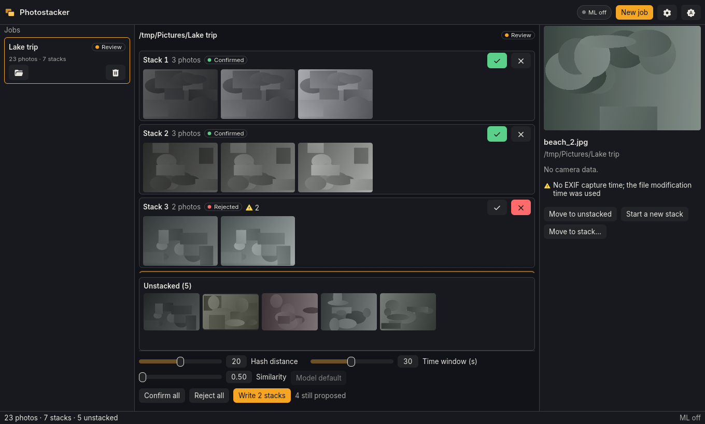

<p align="center">
  
</p>

# Photostacker

Photostacker finds the series of one shot in a folder of photos (exposure brackets, HDR sets, fast bursts) and stacks each series as layers in one PSD, PSB or layered TIFF, ready for Photoshop or any editor that reads layers.

It is a desktop app and a command-line tool. It works offline, only reads your photos, and never writes over a file.



## Status

Photostacker is at version 0.1.0. There is no release yet, so for now it is built from source.

- The tests pass on Linux, on Windows and on macOS (Apple silicon and Intel).
- The packages for the three systems are built and checked by the project's workflows: their contents, what they link, and a run of the command-line tool from each. No person has installed and started the Windows and macOS packages yet, and on macOS the app itself has not been opened yet: only its tests and the command-line tool have run there.
- Photoshop itself has not opened the files yet. Three other programs have (GIMP, PhotoCraft and Photopea): see [docs/photoshop-checks.md](docs/photoshop-checks.md).
- Names in scripts other than Latin, Greek and Cyrillic (Chinese, Japanese, Korean, Arabic, Hebrew, Thai) are drawn with your system's fonts, which may look lighter or smaller than the text around them, and as empty boxes where the system has no font for their script. Arabic and Hebrew words read correctly, but a name of several words, or one with digits or Latin letters inside it, shows its parts in the wrong order.

## What it runs on

| System | Package | The system must be | Visual check |
|---|---|---|---|
| Linux on a 64-bit Intel or AMD PC | `.deb` (Debian, Ubuntu) or `.AppImage` (any distribution) | glibc 2.35 or later, as in Ubuntu 22.04 and later | yes |
| Windows on a 64-bit Intel or AMD PC | installer (`.exe` or `.msi`) or portable `.zip` | Windows 10 or later | yes |
| Mac with Apple silicon | `_aarch64.dmg` | macOS 11 or later | from macOS 14 |
| Mac with an Intel processor | `_x64.dmg` | macOS 11 or later | yes |

glibc is the C library every Linux distribution has; `ldd --version` prints its version. The visual check is an optional step that compares photos by their look ([below](#the-visual-check)). There is no package for any other system, such as Linux or Windows on ARM. [packaging/README.md](packaging/README.md#what-ships-where) says what each package holds.

## Installing

A release, when there is one, holds these packages on the [releases page](https://github.com/riccardogabellone/photostacker/releases), with a `checksums.txt` of their SHA-256 sums. Every package holds the app, the command-line tool and the visual check's runtime; only the visual check's model is downloaded later, if you turn the check on. The packages are not signed, so on Windows and macOS the first start asks for one more step.

### Linux

- **Debian package** (Debian, Ubuntu and the distributions built on them): `sudo apt install ./Photostacker_<version>_amd64.deb`. apt also installs the libraries it needs. Photostacker is then in the applications menu, and the command-line tool, `photostacker-cli`, is on the `PATH`. `sudo apt remove photostacker` removes both.
- **AppImage** (any distribution): make the file executable (`chmod +x Photostacker_<version>_x86_64.AppImage`) and start it. It starts the desktop app; the command-line tool comes with the Debian package. Where FUSE is missing, see [The AppImage and FUSE](packaging/README.md#the-appimage-and-fuse).

### Windows

- **Installer**, `Photostacker_<version>_x64-setup.exe`: installs Photostacker for you alone, into `%LOCALAPPDATA%\Photostacker`, without administrator rights, and adds it to the Start menu.
- **MSI**, `Photostacker_<version>_x64_en-US.msi`: the same app as a Windows Installer package; it needs administrator rights.
- **Portable zip**, `Photostacker_<version>_x64-portable.zip`: unzip it into any folder and start `Photostacker.exe`. Nothing is installed.

SmartScreen may say that it protected your PC from an unrecognised app: choose "More info", then "Run anyway". The command-line tool, `photostacker-cli.exe`, is beside `Photostacker.exe` in the folder the app is installed or unzipped into. It is not on the `PATH`.

### macOS

To see which Mac you have, choose About This Mac in the Apple menu: it names a "Chip" (Apple silicon) or a "Processor" (Intel).

1. Open the disk image, `Photostacker_<version>_aarch64.dmg` for Apple silicon or `Photostacker_<version>_x64.dmg` for Intel, and drag Photostacker into Applications.
2. The app is not signed, so macOS stops its first start with one of two messages, and each has its own remedy:
   - The app "is damaged and can't be opened": this message offers no "Open Anyway". Run `xattr -dr com.apple.quarantine /Applications/Photostacker.app` in Terminal, then open the app again.
   - The app "cannot be opened because the developer cannot be verified" (or Apple "could not verify" it): open the app once, then choose "Open Anyway" in System Settings, Privacy & Security (on macOS 11 and 12: System Preferences, Security & Privacy, General). The `xattr` command above works here too.

The command-line tool is inside the app: `/Applications/Photostacker.app/Contents/MacOS/photostacker-cli`.

## Using the app

Choose `New job`, pick a folder of photos (or drop the folder on the window), and choose `Start`. When the scan ends, the review shows the proposed stacks: confirm or reject them, drag photos between them, then choose `Write <n> stacks`. Settings (the gear in the toolbar) holds the theme, the defaults of new jobs and the visual check.

## Using the command-line tool

The examples assume `photostacker-cli` is on the `PATH`, as the Debian package puts it. On Windows and macOS it is inside the app's folder ([Installing](#installing) says where): give its full path there.

```sh
photostacker-cli run <folder>                   # group the photos and write the stacks into <folder>/stacked
photostacker-cli run <folder> -o <output> --format tiff --recursive
photostacker-cli run <folder> --dry-run --plan plan.json   # group only, and save the plan
photostacker-cli run <folder> --window 45 --hamming 12     # a longer time window, a looser match
photostacker-cli run <folder> --no-ml           # without the visual check
photostacker-cli models list                    # the models of the visual check: also download, import, remove
photostacker-cli info                           # what this build holds: HEIC, ONNX Runtime, the data folder
```

`photostacker-cli --help` lists the commands, and `photostacker-cli run --help` every option with its default.

## How it works

1. **Scan.** A folder is read (its subfolders too, if you ask): JPEG, PNG, TIFF, HEIC and RAW files (CR2, CR3, NEF, ARW, RAF, ORF, RW2, PEF, DNG and the other formats [rawler](https://github.com/dnglab/dnglab) decodes). A RAW and the JPEG beside it count as one photo.
2. **Group.**
   - *By time and camera.* Only shots from the same camera, lens and focal length are compared, each within the time window of the shot before it (30 s by default). A bracket sequence that a Canon, Nikon, Sony or Fujifilm camera records in its metadata is kept to that sequence.
   - *By look.* Two perceptual hashes of a brightness-normalised thumbnail link the shots that show the same frame, so the dark and bright ends of an exposure bracket still match.
   - *By the visual check, if you turn it on.* A DINOv2 model compares the photos of each doubtful stack and splits the ones that only look alike.
3. **Review.** Every proposed stack is shown with its photos. Confirm or reject stacks, drag photos between them, split or merge them, and move the sliders (hash distance, time window, similarity) to regroup at once.
4. **Write.** Each confirmed stack becomes one file, in `<input folder>/stacked` unless you choose another folder:
   - the first shot is the top layer, and each layer is named after its photo, with the exposure of a bracket (`IMG_0412 (−2 EV)`);
   - 8 or 16 bits, with the photos' colour profile; PSB or BigTIFF when a stack is too large for PSD or TIFF;
   - one full-size photo is in memory at a time, so large brackets do not run out of memory;
   - a name that is taken gets `-1`, `-2` and so on.

Jobs are kept in a local database, so a scan or a review can be closed and picked up again. The exact rules are in the [design specification](docs/design.md).

## The visual check

The visual check is off until you turn it on. When the hashes leave a stack in doubt, a model compares its photos by their look, on your computer, and splits those that only look alike. It needs two things:

- **A model,** downloaded once, which the app and the command-line tool share.
  - In the app: in Settings, turn on `Check ambiguous stacks by their look`, then choose `Download` beside a model. dinov2-small (84 MB) is the default. The app asks before it downloads, and names every host it may reach. Without a network, `Import a file…` takes a model file you got elsewhere, checked against the model's SHA-256.
  - With the command-line tool: `photostacker-cli models download dinov2-small`, or `photostacker-cli models import dinov2-small <file>`. `photostacker-cli run` uses dinov2-small when it is installed; `--model` chooses another, and `--no-ml` none.
- **ONNX Runtime,** Microsoft's library that runs the model. Every package holds it. On a Mac with Apple silicon it needs macOS 14 or later: on macOS 11 to 13 the app runs without the visual check and says why. Built from source, see [Building from source](#building-from-source).

Without either, the app and the tool work as before, and the visual check is skipped.

## Where your data is

The job database, the downloaded models and the logs live in your system's application-data folder, and the thumbnails in its cache folder ([the folders of each system](docs/design.md#71-location)). The app's Settings has `Open the logs folder`. Setting `PHOTOSTACKER_DATA_DIR` to a folder moves all of it there, for the app and the command-line tool alike; use it to try things without touching your real data.

## Building from source

You need a [Rust](https://rustup.rs) toolchain, 1.99 or later, a C and C++ compiler, and CMake. On Linux and macOS the recipes use [just](https://github.com/casey/just), 1.15 or later. [AGENTS.md](AGENTS.md#environment) has every requirement, the tests and the packages.

### Linux

On Debian or Ubuntu:

```sh
sudo apt install build-essential cmake pkg-config libde265-dev libegl1 zenity
just ort                                   # once: ONNX Runtime, for the visual check
just run                                   # the desktop app
just run-cli run <folder of photos>        # the command-line tool: group and write the stacks
```

`libde265-dev` is the HEIC decoder, which this build links as a shared library: the quick way for development. The packages and the project's CI link the pinned release of libde265 statically instead, built by `scripts/libde265.sh` ([AGENTS.md](AGENTS.md#environment) says how). `zenity` gives the app its file dialogs on a desktop without an XDG portal.

### Windows

With Visual Studio's "Desktop development with C++" workload (or that of its Build Tools) and the Windows SDK, Rust's MSVC toolchain (`rustup toolchain install stable-x86_64-pc-windows-msvc`), git, and PowerShell 7:

```powershell
pwsh scripts/win.ps1    # builds dist\windows\Photostacker.exe and photostacker-cli.exe, with ONNX Runtime beside them
```

The first run also builds the HEIC decoder (libheif and libde265) with vcpkg, which takes a few minutes and needs the network.

### macOS

These steps follow what the project's workflows do on GitHub's macOS runners; no one has followed them on a Mac of their own yet. You need Xcode's command line tools, and cmake and pkg-config (here from [Homebrew](https://brew.sh)). `<prefix>` is the absolute path of any folder outside the repository.

```sh
xcode-select --install
brew install cmake pkgconf
scripts/libde265.sh <prefix>               # once: libde265, the HEIC decoder, as a static library
export CMAKE_PREFIX_PATH=<prefix> PKG_CONFIG_LIBDIR=<prefix>/lib/pkgconfig
just ort                                   # once: ONNX Runtime, for the visual check
just run                                   # the desktop app
```

## Documentation

| | |
|---|---|
| [docs/design.md](docs/design.md) | The design specification: every rule of the pipeline, the writers, the database, the app and the command-line tool |
| [docs/history.md](docs/history.md) | Where the project came from, and what is still open |
| [docs/calibration.md](docs/calibration.md) | The measurements behind the grouping thresholds |
| [docs/photoshop-checks.md](docs/photoshop-checks.md) | What other programs make of the files Photostacker writes |
| [docs/exif-fixture-coverage.md](docs/exif-fixture-coverage.md) | Which cameras the metadata reader has been checked against |
| [crates/ui/DESIGN.md](crates/ui/DESIGN.md) | The design choices of the desktop app |
| [packaging/README.md](packaging/README.md) | How the packages are built, checked and released |
| [AGENTS.md](AGENTS.md) | How to work in this repository: layout, commands, rules |

## Contributing

`just check` is the gate before every commit: formatting, lints and the tests. [AGENTS.md](AGENTS.md) has the rest.

## Licence

Photostacker is released under the [MIT licence](LICENSE). Its packages also carry other people's work under their own licences, named in [THIRD-PARTY-NOTICES.md](THIRD-PARTY-NOTICES.md) together with the code ported from other projects and the bundled font. Among them, [rawler](https://github.com/dnglab/dnglab) (the RAW decoder) is under the LGPL-2.1, and [libheif](https://github.com/strukturag/libheif) and [libde265](https://github.com/strukturag/libde265) (the HEIC decoder) under the LGPL-3.0; the notices say how to use changed copies of them. HEVC, the codec of HEIC photos, may be covered by patents in some countries: decoding it is the same grey area GIMP and ImageMagick ship with. The DINOv2 models are downloaded, not bundled; they are Apache-2.0.

## Acknowledgements

The perceptual hashes follow Python's [imagehash](https://github.com/JohannesBuchner/imagehash), so that a distance between two hashes means here what it means there.
